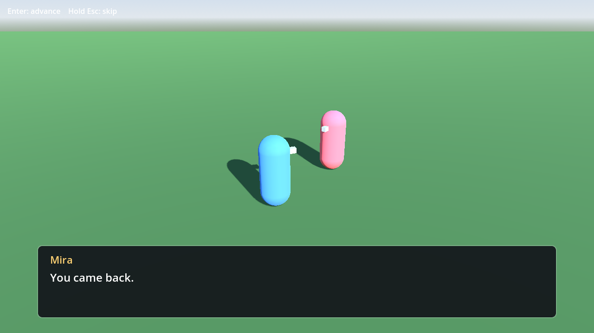

# ergt

A 3D game built in **Godot 4.3**.

## Cutscene system

Cutscenes are short text scripts (`.cut` files) that move characters, turn
them, show dialogue and fade the screen. The full design and roadmap are in
[docs/cutscene-system-design.md](docs/cutscene-system-design.md).



### Try it

Open the project in Godot 4.3 and press **Play**. The demo scene plays
`cutscenes/demo/village.cut`.

- **Enter / Space / click**: show the whole line, or go to the next one
- **Hold Esc for 1 s**: skip the cutscene
- **R** (once it ends): replay

### Writing a cutscene

```
# res://cutscenes/act1/return.cut
fade in 1.0
say narrator "A quiet morning in the village."
move hero to well speed=walk        # walk | run | metres per second
face mira hero                      # face an actor or a marker
say mira "You came back." emotion=sad
wait 0.5
fade out 0.8 color=black
```

Play it from game code:

```gdscript
await CutsceneManager.play("act1/return")
```

Setting up a scene:

- **Characters:** add a `CutsceneActor` node as a child of the character and
  set its `actor_id`. Optionally assign an `AnimationPlayer` with `idle`,
  `walk`, `run` and `talk` animations.
- **Places:** add `Marker3D` nodes. Scripts refer to them by node name.

Mistakes are reported with file and line number before the cutscene starts,
for example `return.cut:4: unknown actor 'bob' (known: hero, mira)`.

| Command | Usage |
|---|---|
| `wait` | `wait <seconds>` |
| `move` | `move <actor> to <marker> [speed=walk\|run\|<m/s>]` |
| `face` | `face <actor> <actor\|marker> [time=<seconds>]` |
| `say` | `say <actor\|narrator> "<text>" [emotion=<name>] [auto=<seconds>]` |
| `fade` | `fade in\|out <seconds> [color=black\|white\|#rrggbb]` |

### Tests

```bash
godot --headless --path . res://tests/run_tests.tscn
```

The tests cover parsing, error reporting, validating scripts against the
scene, and playing the demo through. They also check that skipping leaves the
world in exactly the same state as watching to the end.
