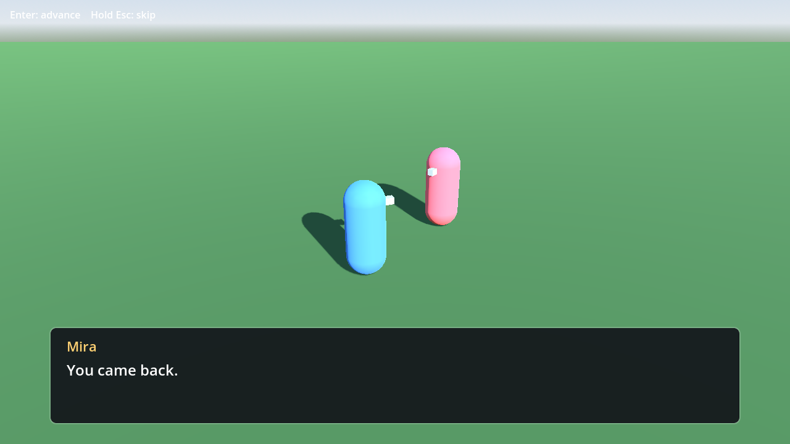

# Cutscene System Design

Status: **M1 implemented** (see [Build plan](#10-build-plan)) · Engine: **Godot 4.3 (GDScript)** · **3D** · **no voice acting**



## 1. Why Godot

The game needs three kinds of cutscene: **in-engine scripted scenes**, **dialogue
scenes** (visual-novel style) and **pre-rendered video**. Godot covers all three
without extra tools:

| Need | What Godot gives us |
|---|---|
| Frame-accurate choreography | `AnimationPlayer` can keyframe *any* property (position, camera zoom, modulate, shader params) and call methods at set times. It works as a built-in timeline editor. |
| Smooth procedural motion | `Tween` handles easing, chaining and parallel moves in a few lines of code. |
| Video | `VideoStreamPlayer` plays Ogg Theora (`.ogv`) files. |
| Dialogue | Built in (`cutscene/ui/dialogue_box.gd`), so it shares the script format and skip logic. |
| Team / git workflow | `.tscn` and `.tres` files are plain text, so cutscene changes show up as readable diffs in pull requests. |
| Cost | Free and open source, with no royalties. |

Decided: Godot 4, 3D. (Unity's Timeline + Cinemachine would also have worked; the
architecture carries over if that ever changes.)

## 2. Core idea: script orchestrates, timelines animate

Cutscenes usually get hard to work on for one of two reasons. Either everything is
hand-written code, which is hard to tune, or everything is one giant timeline,
which can't branch, wait for input or survive a skip. We split the work:

- A **Cutscene Script** is an ordered list of *commands*. It's easy to read,
  supports branching and waiting, and is mostly written by designers and writers.
- **Clips** are short `AnimationPlayer` animations for choreography that needs
  hand tuning, such as a dramatic turn, a camera swoop or a door slam. A script
  plays a clip the same way it plays any other command.

```
CutsceneScript (data)                       CutscenePlayer (runtime)
 ├─ letterbox on                            reads commands one by one,
 ├─ camera_shot "wide_village" 1.5s         awaits each one's completion,
 ├─ move hero -> marker "well" (walk)       handles skip / fast-forward,
 ├─ play_clip "hero_looks_up"   ◄── AnimationPlayer clip (hand-keyed)
 ├─ say mira "You came back." [sad]  ──►    DialogueBox UI
 ├─ choice → branch A / branch B
 ├─ play_video "flashback_01.ogv"    ──►    VideoLayer
 └─ set_flag met_mira = true
```

## 3. Runtime components

All of these are scenes or autoloads under `res://cutscene/`.

| Component | Responsibility |
|---|---|
| `CutsceneManager` (autoload) | Entry point: `CutsceneManager.play("act1_return")`. Pauses gameplay input, loads the script and emits `started`/`finished`. |
| `CutscenePlayer` | Runs commands in order. Each command is a small class with `execute(ctx)` (async; awaited) and `finish_instantly(ctx)`, which is used for skipping. |
| `CutsceneContext` | Gives commands access to actors, markers, camera, UI layers and game flags. |
| `CutsceneActor` | Add as a child of any 3D character to make it scriptable. Its `actor_id` (`"hero"`, `"mira"`) is the name scripts use. Drives the AnimationPlayer (idle/walk/run/talk), or a procedural bob for placeholder meshes. |
| Markers | Any `Marker3D` in the scene, found by node name (`"well"`, `"door_in"`). Scripts use these names instead of raw coordinates, so moving a marker in the level updates the cutscene too. |
| `CutsceneCamera` | A camera rig with named shots, smooth blending between them, follow targets and screen shake. |
| `DialogueBox` | Text box with typewriter text, speaker name, portrait and emotion, choices, voice blips and auto-advance. |
| `VideoLayer` | Fullscreen `VideoStreamPlayer` with fade in and out, subtitles and skip. |
| `Letterbox` / `Fader` | Cinematic bars, fades to and from black, flashes. |

## 4. Command set (v1)

| Command | Example | Notes |
|---|---|---|
| `wait` | `wait 0.5` | |
| `move` | `move hero to well speed=walk` | Plays the walk animation automatically and faces the direction of travel. Ends in idle. |
| `face` | `face mira hero` | |
| `anim` | `anim hero "kneel" wait=true` | Plays one of the actor's own animations. |
| `play_clip` | `play_clip "hero_looks_up"` | Hand-keyed AnimationPlayer clip in the cutscene's scene. |
| `camera` | `camera shot=close_mira blend=1.2 ease=in_out` | Also `follow`, `shake`, `zoom`. |
| `say` | `say mira "You came back." emotion=sad` | Waits for the player to advance unless `auto=2.0` is set. `narrator` = no speaker. No voice acting, so lines are text-only (sound blips in M5). |
| `choice` | `choice "Stay" -> stay, "Leave" -> leave` | Jumps to a label. |
| `label` / `goto` / `if` | `if flag.met_mira goto reunion` | Branching. |
| `play_video` | `play_video "flashback_01.ogv" subs="flashback_01.srt"` | |
| `fade` / `letterbox` / `flash` | `fade out 0.8 color=black` | |
| `sfx` / `music` | `music "theme_sad" crossfade=2` | |
| `set_flag` | `set_flag met_mira true` | Changes persistent game state. |
| `parallel` | `parallel { move ...; camera ... }` | Runs a block of commands together and waits for all of them. |

### Authoring format

Writers work in a small text format (`.cut` files), parsed when the game loads:

```
# res://cutscenes/act1/return.cut
letterbox on
music "theme_village" crossfade=2
camera shot=wide_village blend=0
fade in 1.0

parallel {
  move hero to well speed=walk
  camera follow=hero blend=1.5
}
face mira hero
say mira "You came back." emotion=sad
say hero "I said I would."
choice "Stay" -> stay, "Leave" -> leave

label stay
  play_clip "mira_hug"
  set_flag mira_trust +1
  goto end

label leave
  anim mira "turn_away"
  say mira "...Of course."

label end
fade out 0.8
letterbox off
```

Why plain text: writers can edit it without opening the engine, it diffs cleanly
in pull requests, and the parser can report errors with line numbers, such as an
unknown actor or a missing marker.

## 5. Making it look good (animation quality)

Most of the difference between a stiff cutscene and a polished one comes from a
handful of defaults. These are built into the commands so every scene gets them
without extra work:

1. **Easing on everything.** Camera moves and position tweens default to
   `TRANS_SINE / EASE_IN_OUT`. Linear motion is opt-in.
2. **Animation blending.** Actor animations (idle ↔ walk ↔ run ↔ talk)
   cross-fade over 0.15 s instead of snapping. In 3D, an `AnimationTree` with
   a locomotion blend space can replace this later without changing scripts.
3. **Idle life.** Actors who aren't doing anything keep breathing and blinking, and
   occasionally glance around. Nobody freezes while someone else talks.
4. **Talk animation.** With no voice acting, the typewriter is the voice. `say`
   plays the speaker's talk loop only while text is typing, punctuation adds
   short pauses, and (M5) a per-character text blip sound gives each speaker a
   "voice".
5. **Emotes.** `emotion=` swaps the portrait and can pop an emote bubble
   (! ? ♥ 💧) over the actor, with a small squash-and-stretch bounce.
6. **Anticipation and settle.** `move` adds a short ease-in at the start and a
   slight overshoot-and-settle at the end, so characters don't slide to a halt.
7. **Camera grammar.** Named shots (wide, medium, close, over-the-shoulder) are
   defined once per location. A light camera drift (`camera drift=on`) keeps
   static shots from feeling dead.
8. **Pacing helpers.** `say` adds a short "beat" pause after each line, scaled
   by line length and tunable per line with `beat=`.
9. **Screen polish.** Letterbox bars, vignette, color-grade shifts (via a
   fullscreen shader parameter), and small shakes on impact moments.
10. **Seamless video transitions.** Fade to the video's first frame color, or
    match-cut from a held in-engine pose, so videos don't pop in.

## 6. Skip, fast-forward and saving

- **Skip.** Holding a button for 1 s skips the whole scene. The player calls
  `finish_instantly()` on every remaining command along the current branch. Actors
  snap to their final markers and flags get set, so game state ends up identical
  to watching the scene through. Choices stop the skip and wait for the player.
- **Fast-forward.** Holding a button runs `Engine.time_scale = 3` and speeds up
  the text.
- **Seen-tracking.** A scene is marked seen when it finishes, and replays can be
  skipped instantly.
- **Saving.** Saving is blocked during a cutscene, and the game autosaves right after one.

## 7. Video pipeline

- Export from the video tool at the game resolution, then convert:
  `ffmpeg -i in.mp4 -c:v libtheora -q:v 8 -c:a libvorbis -q:a 5 out.ogv`
- Subtitles go in `.srt` files next to each video, rendered by `VideoLayer`. This
  keeps them localizable instead of burned into the image.
- Keep videos short and few (flashbacks, the intro, the ending). Most story
  should be told in-engine, where it's cheaper to change and matches the game's
  art style.

## 8. Workflow for producing a cutscene

1. **Storyboard.** Write a beat list or rough thumbnails in the cutscene's issue.
2. **Script.** Write the `.cut` file with placeholder lines and markers only.
3. **Block out.** Play it in-game with debug overlays and adjust markers, timings and
   camera shots.
4. **Polish.** Replace the rough parts with hand-keyed `play_clip` animations
   where needed, then add emotes, sound effects and music.
5. **Review.** Open a pull request with a short screen capture attached.

### Dev tools that make this fast

- **Cutscene debugger** (F9 in debug builds): shows the current command and
  line number, and has buttons to step, pause and restart from a chosen label.
- **Hot reload:** saving the `.cut` file restarts the scene from the current label.
- **Jump-to-scene console command:** `cutscene act1_return @stay` plays straight
  from a label, with no need to replay the game to get there.
- **Validator:** a CI script parses every `.cut` file and fails on unknown
  actors, markers, clips or labels.

## 9. Folder layout

```
res://
  cutscene/            # the system (runtime code + UI scenes)
    commands/          # one script per command
    ui/                # DialogueBox, Letterbox, VideoLayer
  cutscenes/           # content
    act1/
      return.cut
      return_clips.tscn   # AnimationPlayer clips used by return.cut
  videos/
    flashback_01.ogv
    flashback_01.srt
  characters/
    mira/ (sprites, portraits, AnimationTree)
```

## 10. Build plan

| Milestone | Scope |
|---|---|
| **M1: Skeleton** ✅ | CutsceneManager and Player, plus the `wait`, `move`, `face`, `say` and `fade` commands. Text parser. One test scene. Skip. Headless tests. |
| **M2: Dialogue** | DialogueBox with portraits, emotions, typewriter text, choices and branching labels. Flags. |
| **M3: Camera and clips** | CutsceneCamera shots, blends and shake. `play_clip`. `parallel`. Letterbox. |
| **M4: Video** | VideoLayer, subtitles, transitions. |
| **M5: Polish and tools** | Skip and fast-forward, debugger overlay, hot reload, CI validator, the idle and emote polish from section 5. |

## Open questions

- ~~2D or 3D?~~ **3D.**
- ~~Voice acting?~~ **No.** Text blips instead (M5).
- Does it need localization from day one? If so, give each `say` line a string
  ID instead of inline text.
- Do characters need to path around obstacles? Right now `move` walks in a
  straight line; a `NavigationAgent3D` path could be added in M3.
